# Alert severity cone

A three-tier traffic cone that visualises alert severity. The selected level lights
its tier and every tier below it.

> ### 👉 [**Try the interactive demo:** https://mrtomrod.github.io/severity-cone-js/](https://mrtomrod.github.io/severity-cone-js/)
> Slider for severity levels, plus a switch between the two cone styles.

| Nothing | Yellow | Orange | Red |
|:---:|:---:|:---:|:---:|
|  |  |  |  |

Two styles ship as standalone SVGs:

| `cone-equal.svg` (equal tier areas) | `cone-classic.svg` (original proportions) |
|:---:|:---:|
|  |  |

Each SVG is driven by a `data-level` attribute on its root element
(`0` nothing, `1` yellow, `2` orange, `3` red).

## Interactive demo

`cone.html` loads the SVGs and adds a severity slider. It's live at
**<https://mrtomrod.github.io/severity-cone-js/>**. It must be served over HTTP (GitHub
Pages does this), because it `fetch`es the SVG files; locally:

```sh
python3 -m http.server   # then open http://localhost:8000/cone.html
```

## For developers

Each cone SVG is driven by a `data-level` attribute on its root `<svg>` element:

| `data-level` | Lit tiers |
|:---:|---|
| `0` | none (all dimmed) |
| `1` | yellow |
| `2` | orange and yellow |
| `3` | red, orange and yellow |

Inline the SVG (an `` tag can't be changed from outside) and set the attribute:

```html
<div id="cone"><!-- contents of cone-equal.svg --></div>
<script>
  document.querySelector('#cone svg').dataset.level = 2; // orange
</script>
```

## Development

See [DEVELOPMENT.md](DEVELOPMENT.md) for local preview and regenerating the state images.
